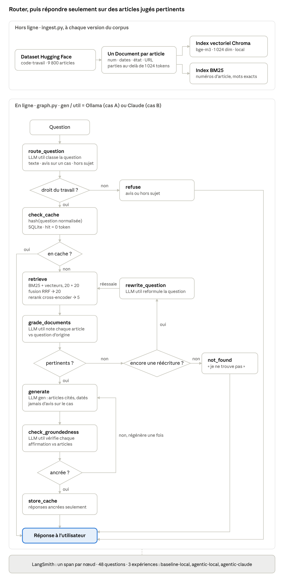
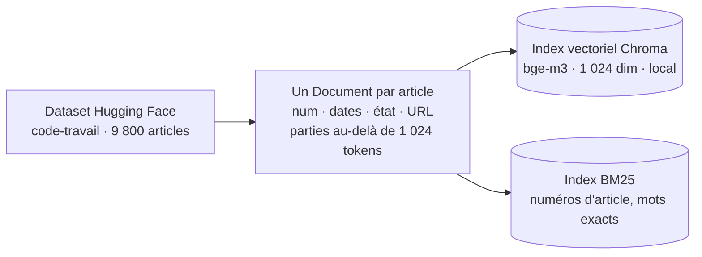
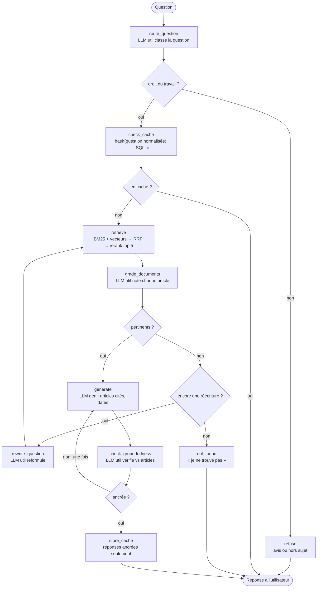

# Berya : RAG juridique pour cabinets d'avocats — prototype et deux cas d'étude

30 octobre 2026 · Patrick Bartosik

Berya (du béryl, la pierre de clarté) est un assistant de recherche juridique sur le Code du travail, construit sur les données publiques Légifrance en un week-end avec Hugging Face, LangChain, LangGraph et LangSmith, puis décliné en deux cas d'étude pour un cabinet : LLM open-weight gouverné sur un serveur du cabinet, ou Claude via API. Repo : `GrandEmpereur/berya`.

## Objectif et cadrage

Le projet se joue en deux phases : un week-end pour construire et mesurer le prototype en local sur ton M3 Pro, puis une semaine (10 à 15 h, ton rythme de la roadmap) pour la variante Claude, les deux cas d'étude, la vidéo et le design de production. Le prototype produit les chiffres ; les cas d'étude les racontent à un cabinet.

Hypothèses prises pour ce doc, à corriger si besoin : le domaine est le droit du travail (le code le plus interrogé par des clients PME, 9 800 articles, un seul dataset à charger), et la machine est ton MacBook Pro 16 pouces M3 Pro, 36 Go de mémoire unifiée, macOS Tahoe, ce qui fixe les modèles locaux du setup.

Ce que le projet doit prouver, chiffres en main :

- Sur 40 questions de droit du travail avec article de référence, le retrieval hybride (BM25 + vecteurs + reranker) retrouve le bon article dans le top 5 plus souvent que le vecteur seul. Mesure : hit@5, déterministe.
- Le graph (routage, grading, réécriture, contrôle d'ancrage) répond mieux qu'une chaîne retrieve → generate, et refuse proprement le hors-périmètre. Mesure : correctness, groundedness, taux de refus justifié.
- Le même graph tourne avec un LLM open-weight local (cas A) et avec Claude (cas B) : même corpus, même jeu d'éval, trois expériences LangSmith comparées sur qualité, latence, coût et confidentialité.
- Chaque réponse cite les articles mot pour mot (numéro, date de version, lien Légifrance) et ne donne jamais d'avis : c'est un outil de recherche, pas un avocat.
- Une question déjà posée revient du cache sans appel LLM.

Livrables :

- [ ] Phase 1 (dimanche soir) : repo `berya` avec `ingest.py`, `retriever.py`, `cache.py`, `graph.py`, `baseline.py`, `eval.py`, README ; index persisté ; jeu d'éval de 40 questions validées ; expériences `baseline-local` et `agentic-local` dans LangSmith ; diagramme du graph
- [ ] Phase 2 (fin de semaine suivante) : expérience `agentic-claude` ; cas d'étude A et B rédigés (même trame, mêmes chiffres) ; vidéo de 2 à 3 min ; schéma de production pour chaque variante ; post LinkedIn

Le projet couvre les modules M3 (RAG), M4 (LangGraph), M5 (du besoin à l'architecture), M6 (evals), M7 (prod) et M8 (gouvernance) du [Campus AI Engineer](https://claude.ai/artifact/HjhSxXjwcvV91jYrkRqJDT) : c'est en pratique ton capstone, avec un vrai client type au bout.

## Contexte et problématique du cabinet

Le cabinet type : un cabinet de droit social de 4 avocats et 2 juristes en Île-de-France, clients PME (licenciements, ruptures conventionnelles, temps de travail, congés, CDD), une trentaine de questions clients par semaine qui commencent toutes par la même tâche : retrouver le bon article du Code du travail, vérifier qu'il est en vigueur, lire les articles liés. Les juristes et les collaborateurs juniors y passent une part importante de leur journée, et une erreur de version (article modifié par une loi récente) coûte cher.

Le problème à résoudre, formulé comme un brief client : « nous voulons qu'un collaborateur obtienne en moins de 30 secondes les articles applicables à une question, à jour, avec leur référence exacte, sans que les faits de nos dossiers sortent du cabinet ». Les deux dernières conditions sont celles qui éliminent ChatGPT grand public et qui justifient un RAG sur mesure.

Critères de succès posés avant la solution (module M5 du campus) :

| Critère | Cible | Comment on le mesure |
| --- | --- | --- |
| Le bon article est dans les 5 proposés | ≥ 85 % des 40 questions de référence | `source_hit` (hit@5), déterministe |
| La réponse est exacte par rapport à la référence | ≥ 80 % | `correctness`, juge LLM |
| La réponse ne dit rien qui ne soit dans les articles cités | ≥ 95 % | `groundedness`, juge LLM |
| Les questions hors périmètre sont refusées | 100 % des 8 questions pièges | `refusal_ok`, déterministe |
| Délai de réponse | ≤ 30 s (cas A local), ≤ 15 s (cas B) | latence p50 dans LangSmith |
| Confidentialité | Aucun fait client ne quitte l'infrastructure choisie | Revue du flux de données, cas A vs cas B |

Les cibles sont des hypothèses de départ : le prototype dira si elles sont atteignables, et le cas d'étude expliquera l'écart. Ce qui est hors périmètre, et doit être dit au cabinet : pas d'avis juridique, pas de rédaction d'actes, pas de jurisprudence dans la phase 1 (elle arrive en extension), pas de conventions collectives.

## Les données juridiques

Le prototype charge le Code du travail depuis Hugging Face en une ligne ; la production ingère la source officielle (DILA) avec ses mises à jour. Les deux sont des données publiques du gouvernement, l'une prête à l'emploi, l'autre à jour.

| Source | Contenu | Colonnes ou format utiles | Usage dans le projet |
| --- | --- | --- | --- |
| [louisbrulenaudet/code-travail](https://huggingface.co/datasets/louisbrulenaudet/code-travail) (Hugging Face, Apache 2.0) | 9 800 articles du Code du travail, version du 11 juillet 2025 | `num` (L1234-9), `texte`, `etat` (VIGUEUR, ABROGE…), `dateDebut`, `dateFin`, `fullSectionsTitre` (chemin livre → section), `id` (LEGIARTI…), `lienCitations` | Phase 1 : le corpus |
| [louisbrulenaudet/code-civil](https://huggingface.co/datasets/louisbrulenaudet/code-civil) et une trentaine d'autres codes du même auteur | Même format, 2 900 articles pour le Code civil | Identiques | Extension multi-codes (un champ `code` en métadonnée suffit) |
| [artefactory/Argimi-Legal-French-Jurisprudence](https://huggingface.co/datasets/artefactory/Argimi-Legal-French-Jurisprudence) (CC BY-SA 4.0) | 147 700 décisions de la Cour de cassation (`juri`), 613 500 du Conseil d'État (`cetat`), 7 300 du Conseil constitutionnel | `content`, `decision_date`, `ecli`, `url`, `summary`, `applied_laws`, `solution` | Extension jurisprudence (phase 2 ou plus tard) : second index, même graph |
| [DILA open data](https://echanges.dila.gouv.fr/OPENDATA/) : LEGI, JORF, KALI, CASS (aussi sur data.gouv.fr) | Codes consolidés avec l'historique des versions, Journal officiel, conventions collectives, jurisprudence judiciaire | XML, mises à jour quotidiennes | Production : la source de vérité du pipeline d'ingestion |
| [API Légifrance](https://piste.gouv.fr/) (PISTE) et Judilibre | Accès programmatique aux textes, versions et décisions | REST, compte PISTE gratuit | Production : vérification à la demande d'un article, liens profonds |

```python
from datasets import load_dataset

raw = load_dataset("louisbrulenaudet/code-travail", split="train")
articles = [r for r in raw if r["etat"] == "VIGUEUR" and r["texte"]]
url = lambda r: f"https://www.legifrance.gouv.fr/codes/article_lc/{r['id']}"
```

Trois choses à dire honnêtement dans le cas d'étude : le corpus du prototype est figé au 11 juillet 2025 (la date figure dans chaque citation), seuls les articles `etat == "VIGUEUR"` sont indexés (compte les autres états dans le README pour montrer que tu sais qu'ils existent), et l'historique des versions nécessaire à « quel texte s'appliquait au 1er mars 2024 ? » vient de LEGI, pas du dataset HF.

## Architecture commune







Le routeur écarte d'emblée les demandes d'avis et le hors-sujet ; le cache sert les questions déjà posées ; le retrieval hybride alimente un grading article par article ; sans article pertinent, la question est réécrite au plus deux fois puis le graph répond « je ne trouve pas » ; la génération cite les articles datés et un contrôle d'ancrage peut la relancer une fois ; seules les réponses ancrées entrent dans le cache. `gen` et `util` sont les deux seuls points où le cas A (Ollama) et le cas B (Claude) diffèrent ; la baseline, c'est `retrieve` en vecteur seul puis `generate`, sans losange.

## Deux cas d'étude : A open-weight on-prem, B Claude API

Même corpus, même index, même graph, même jeu d'éval : seule la fabrique de LLM change. C'est ce qui transforme la comparaison en argument mesuré plutôt qu'en préférence, et c'est le cœur des deux cas d'étude.

Ce qui ne change pas entre A et B : l'ingestion par article, les embeddings et le reranker (locaux dans les deux cas, donc une question n'est jamais envoyée à un tiers pour être vectorisée), le retrieval hybride, le cache, le graph LangGraph, les évaluateurs et le tracing LangSmith. Ce qui change : les deux modèles (`gen` pour répondre, `util` pour router, noter et réécrire), l'endroit où transitent les faits clients, le modèle de coût et la gouvernance.

```python
# llm.py : la seule différence de code entre les deux cas d'étude
import config as C

def make_llms(backend: str = C.BACKEND):
    if backend == "local":
        from langchain_ollama import ChatOllama
        gen  = ChatOllama(model=C.LOCAL_GEN_MODEL,  temperature=0, num_ctx=16384, reasoning=False)
        util = ChatOllama(model=C.LOCAL_UTIL_MODEL, temperature=0, num_ctx=8192,  reasoning=False)
    elif backend == "claude":
        from langchain_anthropic import ChatAnthropic
        gen  = ChatAnthropic(model=C.CLAUDE_GEN_MODEL,  temperature=0, max_tokens=1500)
        util = ChatAnthropic(model=C.CLAUDE_UTIL_MODEL, temperature=0, max_tokens=300)
    else:
        raise ValueError(backend)
    return gen, util
```

|  | Cas A : open-weight gouverné sur un serveur du cabinet | Cas B : Claude via API |
| --- | --- | --- |
| Modèles | Prototype sur le M3 Pro : Mistral Small 3.2 (24 B) pour `gen`, Qwen3 8B pour `util`, servis par Ollama. Production : mêmes poids servis par vLLM sur un serveur GPU du cabinet ou loué chez un hébergeur UE | Claude Sonnet pour `gen`, Claude Haiku pour `util`. Production : même API, ou Claude via AWS Bedrock / Google Vertex en région UE si la résidence des données est exigée |
| Où vont les faits clients | Ne quittent jamais le réseau du cabinet | Transitent par Anthropic (ou le cloud UE choisi) : DPA, durée de rétention et option zero data retention à vérifier et à écrire dans le contrat |
| Qualité attendue | Bonne sur la synthèse d'articles cités, plus fragile sur les questions longues ou multi-articles ; à mesurer | Supérieure sur le raisonnement et le français ; à mesurer sur le même jeu |
| Latence | Plus lente (grading de 5 chunks + génération sur un seul GPU) ; chiffre du prototype à reporter | Plus rapide ; chiffre du prototype à reporter |
| Coût | Matériel ou location GPU + maintenance, tokens gratuits ; à chiffrer en phase 2 avec un devis d'hébergeur UE | Tokens, lus dans LangSmith par question ; tes crédits API mensuels couvrent tout le prototype |
| Gouvernance | Version du modèle figée par le cabinet, aucune dépréciation subie, journal complet en local | Dépréciations de modèles à anticiper (la suite d'evals est le plan de migration), dépendance fournisseur |
| Conformité | Secret professionnel plus simple à démontrer ; RGPD : traitement interne | RGPD : sous-traitant et transferts à encadrer ; AI Act : mêmes obligations de transparence dans les deux cas |
| À recommander quand | Dossiers sensibles, DSI ou infogérant disponible, volume de questions élevé | Petit cabinet sans infrastructure, besoin de qualité maximale rapidement, volume faible |

Le résultat attendu n'est pas « A ou B » mais une grille de décision pour le cabinet, chiffrée par les trois expériences LangSmith (`baseline-local`, `agentic-local`, `agentic-claude`). Un troisième chemin, à mentionner sans le construire : Mistral via son API européenne, entre les deux sur la souveraineté et le coût.

## Setup technique sur le M3 Pro (1 h samedi matin)

Avec 36 Go de mémoire unifiée, le Mac fait tourner en même temps un modèle de 24 B en 4 bits (≈ 15 Go), un 8 B (≈ 5 Go), les embeddings et le reranker (≈ 2 Go), avec de la marge pour Chroma et le système. Tout le cas A tourne donc sur ta machine sans rien louer.

| Brique | Choix pour 36 Go | Pourquoi |
| --- | --- | --- |
| LLM `gen` (cas A) | `mistral-small3.2` via Ollama (24 B, quantifié 4 bits) | Fort en français, éditeur européen : l'argument souveraineté du cas d'étude A. Alternative plus rapide : `qwen3:30b-a3b` (MoE, 3 B actifs) |
| LLM `util` (cas A) | `qwen3:8b` via Ollama | Rapide pour les 5 à 15 appels courts par question (routage, grading, réécriture), tool calling fiable pour `with_structured_output` |
| LLM (cas B) | Claude Sonnet (`gen`) et Claude Haiku (`util`), identifiants courants à relever sur la page Models de la doc Claude | Qualité maximale ; couvert par tes crédits API mensuels |
| Embeddings | `BAAI/bge-m3` (1 024 dimensions, multilingue), local sur `mps` | Français juridique bien couvert ; alternative `Qwen/Qwen3-Embedding-0.6B` |
| Reranker | `BAAI/bge-reranker-v2-m3`, local sur `mps` | Multilingue, même famille que l'embedding |
| Juge des evals | Claude Haiku pour les trois expériences | Un seul juge pour comparer ; biais d'auto-préférence sur `agentic-claude` à écrire dans les limites |

```bash
# Ollama : une seule fois, pendant que tu lis la suite du doc (≈ 20 Go à télécharger)
brew install ollama && brew services start ollama
ollama pull mistral-small3.2 && ollama pull qwen3:8b
ollama run qwen3:8b "Réponds OK."          # vérifie que ça tourne sur le GPU Metal

uv init berya && cd berya && uv python pin 3.14
uv add datasets langchain langchain-core langchain-text-splitters langchain-huggingface \
       sentence-transformers langchain-chroma langchain-community rank_bm25 \
       langchain-ollama langchain-anthropic langgraph langsmith python-dotenv pandas
```

```bash
# .env (copie .env.example, jamais commité)
BERYA_BACKEND=local             # local | claude
ANTHROPIC_API_KEY=sk-ant-...    # cas B + juge des evals
HF_TOKEN=hf_...                 # téléchargement des modèles d'embedding (optionnel)
LANGSMITH_TRACING=true
LANGSMITH_API_KEY=lsv2_...
LANGSMITH_PROJECT=berya
```

```text
berya/
├── CLAUDE.md        # règles du repo pour Claude Code (section Lancement, en fin de doc)
├── config.py        # modèles, tailles, k, chemins, backend : une seule source de vérité
├── llm.py           # make_llms(backend) : local (Ollama) ou claude
├── ingest.py        # dataset HF → un Document par article → Chroma + BM25 dans ./index/
├── retriever.py     # hybrid_retrieve(question) : BM25 + vecteurs → RRF → rerank, filtre etat
├── cache.py         # cache exact SQLite, clé = question normalisée + version de config
├── graph.py         # route → cache → retrieve → grade → generate → check → store
├── baseline.py      # vecteur seul → generate, sans graph
├── build_evalset.py # génère 60 questions candidates à valider → evalset.jsonl
├── eval.py          # dataset LangSmith + evaluate() pour baseline-local, agentic-local, agentic-claude
├── prompts.py       # ROUTE_PROMPT, GRADE_PROMPT, REWRITE_PROMPT, ANSWER_PROMPT, GROUND_PROMPT (+ ceux des juges)
├── index/           # chroma/, bm25.pkl, cache.sqlite (gitignorés)
├── docs/            # cadrage-berya.md, architecture.png, graph.png, cas-etude-A.md, cas-etude-B.md, storyboard.md
└── README.md
```

Smoke test, critère de sortie du bloc :

```python
# smoke.py
from dotenv import load_dotenv; load_dotenv()
from langchain_huggingface import HuggingFaceEmbeddings
from langchain_anthropic import ChatAnthropic
from langsmith import Client
from llm import make_llms

emb = HuggingFaceEmbeddings(model_name="BAAI/bge-m3", model_kwargs={"device": "mps"},
                            encode_kwargs={"normalize_embeddings": True})
print("embedding dim:", len(emb.embed_query("préavis de démission")))      # 1024

gen, util = make_llms("local")
print("Ollama gen :", gen.invoke("Réponds OK.").content)
print("Ollama util:", util.invoke("Réponds OK.").content)

print("Claude:", ChatAnthropic(model="claude-haiku-4-5", temperature=0).invoke("Réponds OK.").content)

next(Client().list_datasets(limit=1), None)   # lève une erreur si la clé LangSmith est invalide
print("LangSmith OK : les trois appels LLM ci-dessus sont tracés dans le projet berya")
```

Fige les versions avec `uv lock` et note-les dans le README avec le nom et la dimension du modèle d'embedding : changer d'embedding plus tard oblige à réindexer, et le cas d'étude doit pouvoir être reproduit.

## Planning

Le week-end produit le prototype local et ses chiffres ; la semaine suivante (hors mardi et mercredi, tes jours au bureau) ajoute la variante Claude, les cas d'étude, la vidéo et le design de production. Chaque bloc a un critère de sortie : atteint, tu avances.

**Samedi : corpus, index, jeu d'éval, baseline (≈ 6 h 30)**

| Heure | Bloc | Ce que tu fais | Critère de sortie |
| --- | --- | --- | --- |
| 9h00 – 10h00 | Setup | `ollama pull` en arrière-plan, `uv`, `.env`, structure du repo, `smoke.py` | Les quatre appels (embedding, Ollama gen, Ollama util, Claude) passent et les trois appels LLM apparaissent dans LangSmith |
| 10h00 – 11h15 | Ingestion par article | `ingest.py` : un `Document` par article en vigueur, texte = numéro + chemin de sections + texte, métadonnées complètes, statistiques (nombre, longueur en tokens, états écartés) | Nombre d'articles indexés affiché, aucun texte vide, URL Légifrance construite pour chacun |
| 11h15 – 12h30 | Index + fusion | Embeddings bge-m3 sur `mps`, Chroma persisté, BM25 picklé, RRF à la main | `hybrid_retrieve("préavis en cas de démission")` renvoie L1237-1 dans le top 5 ; `hybrid_retrieve("L1234-9")` renvoie l'article lui-même en premier |
| 12h30 – 13h30 | Pause | Lancer `build_evalset.py` avant de partir (60 questions candidates générées par qwen3:8b) |  |
| 13h30 – 14h45 | Jeu d'éval | Valider à la main les candidates (garder 40 : question claire, réponse dans l'article, article id correct), écrire 8 questions hors périmètre (avis, droit pénal, bavardage) | `evalset.jsonl` de 48 lignes, chacune avec `question`, `answer`, `article_id`, `in_scope` |
| 14h45 – 15h30 | Reranker + mesure | `CrossEncoder` bge-reranker-v2-m3 ; `hit_at_k.py` sur les 40 questions : vecteur, BM25, fusion, fusion + rerank | Tableau de 4 lignes ; fusion + rerank au-dessus du vecteur seul, sinon on cherche le bug |
| 15h30 – 16h30 | Baseline + LangSmith | `baseline.py`, `eval.py` : dataset LangSmith de 48 exemples, évaluateurs `source_hit` et `refusal_ok`, run `baseline-local` | L'expérience `baseline-local` est visible avec ses scores ; 3 causes d'échec notées dans le README |

**Dimanche : graph, comparaison, matériau du cas d'étude (≈ 6 h 30)**

| Heure | Bloc | Ce que tu fais | Critère de sortie |
| --- | --- | --- | --- |
| 9h00 – 11h00 | Graph | `graph.py` : route\_question, check\_cache, retrieve, grade\_documents, rewrite\_question, generate, check\_groundedness, store\_cache ; `draw_mermaid_png()` | Les 4 passages de démo passent : question directe, question floue (réécriture), question hors périmètre (refus), question reposée (cache) |
| 11h00 – 12h00 | Lancement de l'eval | `eval.py` sur le graph avec les 5 évaluateurs, run `agentic-local` (compte 1 à 2 h en local) ; pendant ce temps, README section « Diagnostic » | L'expérience tourne ; les premiers exemples sont lisibles dans LangSmith |
| 12h00 – 13h00 | Pause | L'eval continue |  |
| 13h00 – 14h00 | Lecture des résultats | Comparaison `baseline-local` vs `agentic-local`, ouverture des échecs, une correction seulement si c'est un bug (pas un réglage) | Tableau de comparaison exporté ; liste des échecs typiques avec exemples |
| 14h00 – 15h30 | README + matériau | Diagramme, tableau hit@5, tableau d'expériences, coût et latence par question, limites ; captures d'écran des 4 passages de démo pour la vidéo | Le repo se lit seul ; un inconnu relance `ingest.py` puis `graph.py` |
| 15h30 – 16h30 | Répétition | Démo chronométrée de 10 min, LangSmith ouvert ; brouillon du post LinkedIn | Tu tiens 10 min sans notes et tu réponds aux questions d'entretien du M3 |

**Semaine 2 : variante Claude, cas d'étude, vidéo, production (≈ 12 h)**

| Jour | Durée | Bloc | Critère de sortie |
| --- | --- | --- | --- |
| Lundi | 2 h | `BERYA_BACKEND=claude` : smoke, run `agentic-claude` (rapide), tableau à trois expériences, coût en tokens relevé | Tableau final avec qualité, latence et coût par question pour A et B |
| Jeudi | 3 h | Rédaction des cas d'étude A et B (trame plus bas) + schémas de production des deux variantes | Deux documents relus, mêmes chiffres, conclusions différentes et argumentées |
| Vendredi | 3 h | Vidéo : storyboard, captures des 4 passages sur les deux backends, montage HyperFrames, voix | Vidéo de 2 à 3 min exportée |
| Samedi | 3 à 4 h | Relecture, repo public, page portfolio, post LinkedIn programmé (vendredi 17h), envoi à 2 ou 3 cabinets de ta prospection | Tout est en ligne ; un cabinet peut lire le cas d'étude et voir la vidéo sans toi |

Si samedi dérape, la variable d'ajustement est le jeu d'éval : 25 questions validées plutôt que 40, jamais zéro. Si dimanche dérape, c'est la répétition qui saute, pas l'eval `agentic-local` : sans elle, pas de cas d'étude.

## Squelettes de code

Ces squelettes sont le brief à donner à Claude Code, fichier par fichier : ils fixent les interfaces pour que tu puisses relire ce qui sort avec les checklists du campus. Les prompts sont en français (corpus et utilisateurs français) ; ils restent à écrire, cinq à dix lignes chacun, et leur version figure dans `config.py` parce qu'elle fait partie de la clé de cache.

**1. `config.py`**

```python
import os
BACKEND = os.getenv("BERYA_BACKEND", "local")   # local | claude

EMBED_MODEL      = "BAAI/bge-m3"                 # 1024 dims
RERANK_MODEL     = "BAAI/bge-reranker-v2-m3"
LOCAL_GEN_MODEL  = "mistral-small3.2"            # Ollama
LOCAL_UTIL_MODEL = "qwen3:8b"                    # Ollama
CLAUDE_GEN_MODEL  = "claude-sonnet-4-5"          # à aligner sur la page Models de la doc Claude
CLAUDE_UTIL_MODEL = "claude-haiku-4-5"
JUDGE_MODEL       = "claude-haiku-4-5"
GEN_NAME  = LOCAL_GEN_MODEL  if BACKEND == "local" else CLAUDE_GEN_MODEL
UTIL_NAME = LOCAL_UTIL_MODEL if BACKEND == "local" else CLAUDE_UTIL_MODEL

MAX_ARTICLE_TOKENS = 1024                        # au-delà, l'article est découpé en parties
K_BM25, K_VEC, K_FUSED, K_FINAL = 20, 20, 20, 5
MAX_REWRITES    = 2
PROMPTS_VERSION = "v1"
CACHE_TTL_S     = 7 * 24 * 3600
CORPUS_VERSION  = "code-travail-2025-07-11"
INDEX_DIR       = "index"
```

**2. `ingest.py` : un `Document` par article**

```python
from datasets import load_dataset
from langchain_core.documents import Document
from langchain_text_splitters import RecursiveCharacterTextSplitter
from langchain_huggingface import HuggingFaceEmbeddings
from langchain_chroma import Chroma
from langchain_community.retrievers import BM25Retriever
from transformers import AutoTokenizer
from datetime import datetime, timezone
import pickle, collections, config as C

raw = load_dataset("louisbrulenaudet/code-travail", split="train")
print(collections.Counter(r["etat"] for r in raw))          # à reporter dans le README
day = lambda ms: datetime.fromtimestamp(ms / 1000, tz=timezone.utc).date().isoformat() if ms else ""

docs = []
for r in raw:
    if r["etat"] != "VIGUEUR" or not r["texte"]:
        continue
    header = f"Article {r['num']} du Code du travail\n{r['fullSectionsTitre']}\n\n"
    docs.append(Document(page_content=header + r["texte"], metadata={
        "code": "Code du travail", "num": r["num"], "article_id": r["id"],
        "etat": r["etat"], "date_debut": day(r["dateDebut"]), "date_fin": day(r["dateFin"]),
        "section": r["fullSectionsTitre"],
        "url": f"https://www.legifrance.gouv.fr/codes/article_lc/{r['id']}",
        "corpus_version": C.CORPUS_VERSION}))

# L'article est l'unité ; seuls les très longs sont découpés, en gardant l'en-tête et les métadonnées
tok = AutoTokenizer.from_pretrained(C.EMBED_MODEL)
splitter = RecursiveCharacterTextSplitter.from_huggingface_tokenizer(
    tok, chunk_size=C.MAX_ARTICLE_TOKENS, chunk_overlap=100, separators=["\n\n", "\n", ". ", " "])
chunks = []
for d in docs:
    parts = splitter.split_documents([d])
    for i, p in enumerate(parts):
        p.metadata["chunk_id"] = f"{d.metadata['article_id']}#{i}"
        p.metadata["n_parts"] = len(parts)
        chunks.append(p)
print(len(docs), "articles en vigueur →", len(chunks), "chunks")

emb = HuggingFaceEmbeddings(model_name=C.EMBED_MODEL, model_kwargs={"device": "mps"},
                            encode_kwargs={"normalize_embeddings": True, "batch_size": 32})
store = Chroma(collection_name="code_travail", embedding_function=emb,
               persist_directory=f"{C.INDEX_DIR}/chroma")
for i in range(0, len(chunks), 2000):                       # lots : limite de batch Chroma
    store.add_documents(chunks[i:i + 2000])
pickle.dump(BM25Retriever.from_documents(chunks, k=C.K_BM25), open(f"{C.INDEX_DIR}/bm25.pkl", "wb"))
```

**3. `retriever.py` : hybride, RRF, rerank**

```python
import pickle, config as C
from langchain_huggingface import HuggingFaceEmbeddings
from langchain_chroma import Chroma
from sentence_transformers import CrossEncoder
from langsmith import traceable

emb      = HuggingFaceEmbeddings(model_name=C.EMBED_MODEL, model_kwargs={"device": "mps"},
                                 encode_kwargs={"normalize_embeddings": True})
chroma   = Chroma(collection_name="code_travail", persist_directory=f"{C.INDEX_DIR}/chroma",
                  embedding_function=emb)
bm25     = pickle.load(open(f"{C.INDEX_DIR}/bm25.pkl", "rb"))
reranker = CrossEncoder(C.RERANK_MODEL, device="mps")

@traceable(name="hybrid_retrieve")
def hybrid_retrieve(question: str, k_final: int = C.K_FINAL):
    vec_hits  = chroma.similarity_search(question, k=C.K_VEC, filter={"etat": "VIGUEUR"})
    bm25_hits = bm25.invoke(question)[:C.K_BM25]          # retrouve « L1234-9 » là où l'embedding échoue

    scores, by_id = {}, {}                                 # Reciprocal Rank Fusion
    for hits in (vec_hits, bm25_hits):
        for rank, d in enumerate(hits):
            cid = d.metadata["chunk_id"]
            scores[cid] = scores.get(cid, 0) + 1 / (60 + rank)
            by_id[cid] = d
    fused = [by_id[c] for c, _ in sorted(scores.items(), key=lambda x: -x[1])][:C.K_FUSED]

    rr = reranker.predict([(question, d.page_content) for d in fused])
    return [d for _, d in sorted(zip(rr, fused), key=lambda x: -x[0])][:k_final]
```

**4. `cache.py`** : inchangé par rapport à la version précédente du doc (cache exact SQLite, clé = `sha256(version_config | question normalisée)`, TTL), avec `CORPUS_VERSION` et `PROMPTS_VERSION` dans la version de config pour qu'une réindexation ou un nouveau prompt invalide tout.

**5. `graph.py` : routage, cache, retrieval, grading, génération citée, contrôle**

```python
from typing import Literal, TypedDict
from pydantic import BaseModel, Field
from langgraph.graph import StateGraph, START, END
from langchain_core.documents import Document
from llm import make_llms
from retriever import hybrid_retrieve
from cache import cache_key, cache_get, cache_put
import config as C

gen, util = make_llms()

class RAGState(TypedDict):
    question: str; original_question: str
    route: str                      # "droit_travail" | "hors_perimetre" | "avis_juridique"
    use_cache: bool; cache_key: str; cached: bool
    documents: list[Document]; answer: str; sources: list[dict]
    rewrites: int; grounded: bool; regenerated: bool

class Route(BaseModel):
    route: Literal["droit_travail", "hors_perimetre", "avis_juridique"] = Field(
        description="droit_travail = question de recherche sur le Code du travail ; "
                    "avis_juridique = demande un conseil sur un cas précis ; hors_perimetre = le reste")

class DocGrade(BaseModel):
    relevant: bool

class GroundGrade(BaseModel):
    explanation: str
    grounded: bool

router, grader, checker = (util.with_structured_output(Route),
                           util.with_structured_output(DocGrade),
                           util.with_structured_output(GroundGrade))

def route_question(state: RAGState):
    return {"route": router.invoke(ROUTE_PROMPT.format(q=state["original_question"])).route}

def refuse(state: RAGState):
    msg = {"avis_juridique": "Je peux retrouver les articles applicables, pas donner un avis sur un cas : "
                             "reformulez en question sur le texte (ex. « quelles conditions pose L1232-2 ? »).",
           "hors_perimetre": "Cette question sort du Code du travail indexé."}
    return {"answer": msg[state["route"]], "sources": []}

def check_cache(state: RAGState):
    key = cache_key(state["original_question"])
    hit = cache_get(key) if state["use_cache"] else None
    return {"cache_key": key, "cached": True, **hit} if hit else {"cache_key": key, "cached": False}

def retrieve(state: RAGState):
    return {"documents": hybrid_retrieve(state["question"])}

def grade_documents(state: RAGState):
    keep = [d for d in state["documents"]
            if grader.invoke(GRADE_PROMPT.format(q=state["original_question"], doc=d.page_content)).relevant]
    return {"documents": keep}

def rewrite_question(state: RAGState):
    better = util.invoke(REWRITE_PROMPT.format(q=state["original_question"])).content.strip()
    return {"question": better, "rewrites": state["rewrites"] + 1}

def generate(state: RAGState):
    ctx = "\n\n".join(f"[{d.metadata['num']} | en vigueur depuis {d.metadata['date_debut']} | {d.metadata['url']}]\n"
                      f"{d.page_content}" for d in state["documents"])
    out = gen.invoke(ANSWER_PROMPT.format(q=state["original_question"], context=ctx)).content
    srcs = {d.metadata["article_id"]: {"num": d.metadata["num"], "url": d.metadata["url"],
                                       "date_debut": d.metadata["date_debut"],
                                       "corpus_version": C.CORPUS_VERSION} for d in state["documents"]}
    return {"answer": out, "sources": list(srcs.values()), "regenerated": bool(state["answer"])}

def check_groundedness(state: RAGState):
    return {"grounded": checker.invoke(GROUND_PROMPT.format(answer=state["answer"], docs=state["documents"])).grounded}

def store_cache(state: RAGState):
    if state["use_cache"]:
        cache_put(state["cache_key"], state["original_question"], state["answer"], state["sources"])
    return {}

def not_found(state: RAGState):
    return {"answer": "Je ne trouve pas d'article du Code du travail répondant à cette question.", "sources": []}

def after_route(state) -> Literal["check_cache", "refuse"]:
    return "check_cache" if state["route"] == "droit_travail" else "refuse"

def after_cache(state) -> Literal["__end__", "retrieve"]:
    return END if state["cached"] else "retrieve"

def after_grading(state) -> Literal["generate", "rewrite_question", "not_found"]:
    if state["documents"]:
        return "generate"
    return "rewrite_question" if state["rewrites"] < C.MAX_REWRITES else "not_found"

def after_check(state) -> Literal["store_cache", "generate", "__end__"]:
    if state["grounded"]:
        return "store_cache"
    return END if state["regenerated"] else "generate"

g = StateGraph(RAGState)
for n in (route_question, refuse, check_cache, retrieve, grade_documents, rewrite_question,
          generate, check_groundedness, store_cache, not_found):
    g.add_node(n)
g.add_edge(START, "route_question")
g.add_conditional_edges("route_question", after_route)
g.add_conditional_edges("check_cache", after_cache)
g.add_edge("retrieve", "grade_documents")
g.add_conditional_edges("grade_documents", after_grading)
g.add_edge("rewrite_question", "retrieve")
g.add_edge("generate", "check_groundedness")
g.add_conditional_edges("check_groundedness", after_check)
for n in ("refuse", "store_cache", "not_found"):
    g.add_edge(n, END)
graph = g.compile()
open("docs/graph.png", "wb").write(graph.get_graph().draw_mermaid_png())

def ask(q: str, use_cache: bool = True) -> dict:
    return graph.invoke({"question": q, "original_question": q, "route": "", "use_cache": use_cache,
                         "cache_key": "", "cached": False, "documents": [], "answer": "", "sources": [],
                         "rewrites": 0, "grounded": False, "regenerated": False})
```

À relire en priorité : `grade_documents` note contre `original_question` (pas la version réécrite) ; la régénération après `check_groundedness` ne tourne qu'une fois ; `ANSWER_PROMPT` impose de citer les articles par leur numéro, de reprendre le texte entre guillemets, de préciser « version du corpus : 11 juillet 2025 » et de ne jamais conclure sur le cas de la personne ; `ROUTE_PROMPT` donne trois exemples par classe, dont un cas limite (« mon employeur me licencie, que faire ? » = avis\_juridique, « quelles sont les causes réelles et sérieuses de licenciement ? » = droit\_travail).

**6. `baseline.py`**

```python
def baseline(q: str) -> dict:
    docs = chroma.similarity_search(q, k=C.K_FINAL, filter={"etat": "VIGUEUR"})   # vecteur seul
    ctx = "\n\n".join(d.page_content for d in docs)
    return {"answer": gen.invoke(ANSWER_PROMPT.format(q=q, context=ctx)).content, "documents": docs,
            "sources": [{"num": d.metadata["num"], "url": d.metadata["url"]} for d in docs]}
```

`baseline(q)` et `ask(q)` renvoient le même dictionnaire (`answer`, `documents`, `sources`), ce qui permet à `eval.py` de leur appliquer les mêmes évaluateurs, et `ask` fonctionne à l'identique avec `BERYA_BACKEND=local` ou `claude`.

## Évaluation avec LangSmith

Il n'existe pas de jeu de questions prêt à l'emploi sur le Code du travail : tu le construis samedi (une heure et quart), et c'est lui qui rend les trois expériences comparables. Cinq évaluateurs, dont deux déterministes, un seul juge LLM pour les trois expériences.

**Construire le jeu d'éval (`build_evalset.py`)** : tirer 60 articles au hasard parmi ceux de plus de 300 caractères, demander à `qwen3:8b` pour chacun une question qu'un collaborateur de cabinet poserait et dont la réponse est dans l'article (sans mentionner son numéro), plus la réponse en deux phrases ; faire noter par le même modèle si la question est compréhensible seule (1 à 5) et utile pour un juriste (1 à 5), comme dans le jeu d'éval du cookbook Hugging Face ; garder les candidates ≥ 4 / 4 et les valider à la main pour en conserver 40. Ajouter 8 questions hors périmètre écrites par toi : 3 demandes d'avis sur un cas (« mon patron veut me licencier, qu'est-ce que je fais ? »), 3 hors droit du travail (fiscalité, pénal, bail), 2 de bavardage. Format : une ligne JSON par exemple, `{"question", "answer", "article_id", "num", "in_scope"}`.

| Évaluateur | Type | Ce qu'il mesure | S'applique à |
| --- | --- | --- | --- |
| `source_hit` (hit@5) | Code, déterministe | L'`article_id` de référence est parmi les sources retournées | 40 questions in\_scope |
| `refusal_ok` | Code, déterministe | Hors périmètre : la réponse est un refus sans article cité ; in\_scope : la réponse n'est pas un refus | Les 48 |
| `correctness` | Juge LLM (Claude Haiku) | La réponse est conforme à la réponse de référence | 40 in\_scope |
| `groundedness` | Juge LLM | Chaque affirmation est soutenue par les articles cités | 40 in\_scope |
| `citation_ok` | Code, déterministe | Chaque numéro d'article mentionné dans la réponse (regex `L\d{4}-\d+`, `R\d{4}-\d+`) figure dans les sources retournées : pas d'article inventé | 40 in\_scope |

```python
# eval.py (extraits)
import json, re
from langsmith import Client
from langchain_anthropic import ChatAnthropic
from pydantic import BaseModel
from baseline import baseline
from graph import ask
import config as C

client, DATASET = Client(), "berya-code-travail-48"
if not client.has_dataset(dataset_name=DATASET):
    ds = client.create_dataset(DATASET, description="40 questions Code du travail + 8 hors périmètre, validées à la main")
    rows = [json.loads(l) for l in open("evalset.jsonl")]
    client.create_examples(dataset_id=ds.id, examples=[
        {"inputs": {"question": r["question"]},
         "outputs": {"answer": r["answer"], "article_id": r["article_id"], "in_scope": r["in_scope"]}} for r in rows])

ART = re.compile(r"\b[LRD]\d{3,4}-\d+(?:-\d+)?\b")

def source_hit(outputs, reference_outputs) -> bool | None:
    if not reference_outputs["in_scope"]:
        return None                                   # non applicable → ignoré dans la moyenne
    return any(s.get("article_id") == reference_outputs["article_id"] for s in outputs["sources"])

def refusal_ok(outputs, reference_outputs) -> bool:
    refused = not outputs["sources"]
    return refused if not reference_outputs["in_scope"] else not refused

def citation_ok(outputs, reference_outputs) -> bool | None:
    if not reference_outputs["in_scope"]:
        return None
    cited = set(ART.findall(outputs["answer"]))
    return cited <= {s["num"] for s in outputs["sources"]}

class Grade(BaseModel):
    explanation: str
    passed: bool
judge = ChatAnthropic(model=C.JUDGE_MODEL, temperature=0).with_structured_output(Grade)

def correctness(inputs, outputs, reference_outputs) -> bool | None:
    if not reference_outputs["in_scope"]:
        return None
    return judge.invoke(CORRECTNESS_PROMPT.format(q=inputs["question"], ref=reference_outputs["answer"],
                                                  ans=outputs["answer"])).passed

def groundedness(inputs, outputs, reference_outputs) -> bool | None:
    if not reference_outputs["in_scope"]:
        return None
    facts = "\n\n".join(d.page_content for d in outputs["documents"])
    return judge.invoke(GROUNDED_PROMPT.format(facts=facts, ans=outputs["answer"])).passed

EVALS = [source_hit, refusal_ok, citation_ok, correctness, groundedness]
META  = {"backend": C.BACKEND, "gen": C.GEN_NAME, "util": C.UTIL_NAME, "embed": C.EMBED_MODEL,
         "rerank": C.RERANK_MODEL, "k": C.K_FINAL, "corpus": C.CORPUS_VERSION, "prompts": C.PROMPTS_VERSION}

client.evaluate(lambda x: baseline(x["question"]), data=DATASET, evaluators=EVALS,
                experiment_prefix=f"baseline-{C.BACKEND}", max_concurrency=2, metadata=META)
client.evaluate(lambda x: ask(x["question"], use_cache=False), data=DATASET, evaluators=EVALS,
                experiment_prefix=f"agentic-{C.BACKEND}", max_concurrency=2, metadata=META)
```

Trois expériences, lancées dans cet ordre : `baseline-local` et `agentic-local` le week-end (`max_concurrency=2` pour ne pas saturer Ollama), `agentic-claude` le lundi suivant (`max_concurrency=4`). Les métadonnées portent le backend, les modèles, la version du corpus et des prompts : c'est ce qui rend le tableau défendable six mois plus tard.

| Expérience | hit@5 | refusal\_ok | citation\_ok | correctness | groundedness | Latence p50 | Tokens ou coût / question |
| --- | --- | --- | --- | --- | --- | --- | --- |
| `baseline-local` (vecteur seul, Mistral Small) |  |  |  |  |  |  |  |
| `agentic-local` (graph complet, Mistral Small + Qwen3 8B) |  |  |  |  |  |  |  |
| `agentic-claude` (graph complet, Sonnet + Haiku) |  |  |  |  |  |  |  |

Ce que tu lis dans LangSmith après chaque run : la vue de comparaison des expériences, le filtre `correctness = false` pour ouvrir les échecs, une trace où `rewrite_question` s'est déclenché, une trace de refus, et les tokens par nœud sur l'expérience Claude pour le coût. Deux limites à écrire dans le cas d'étude : le juge est un modèle Claude, donc `agentic-claude` est jugé par sa propre famille (biais d'auto-préférence, les deux évaluateurs déterministes servent de contrepoids) ; et le jeu de 40 questions a été généré puis validé par toi, pas par un avocat, ce qui est la première chose à corriger avec un vrai cabinet.

## Cas d'étude écrits et vidéo

Les deux cas d'étude suivent la même trame et partagent les mêmes chiffres ; ils diffèrent par le déploiement, le flux des données, le coût et la conclusion. La vidéo montre les mêmes quatre passages sur les deux variantes, côte à côte.

**Trame d'un cas d'étude (4 à 6 pages, `docs/cas-etude-A.md` et `-B.md`)**

1. Le cabinet et le problème : la persona de la section Contexte, le brief en une phrase, les critères de succès chiffrés.
2. Les données : Code du travail (Légifrance via Hugging Face pour le prototype, DILA en production), ce qui est indexé et ce qui ne l'est pas, la date de version.
3. L'architecture : le diagramme commun, puis le schéma de déploiement propre à la variante (serveur du cabinet pour A, API et région pour B) avec le trajet d'une question en cinq flèches.
4. Les résultats : le tableau hit@5 des quatre retrievals, le tableau des trois expériences, trois exemples commentés (une réussite, un échec, un refus) avec captures LangSmith.
5. Coût et délai : coût par question et par mois pour 30 questions par semaine, latence p50 et p95, coût de mise en place (matériel ou abonnement) ; pour A, un ordre de grandeur de serveur GPU ou de location UE obtenu sur un devis réel, pas inventé.
6. Conformité et gouvernance : secret professionnel, RGPD, AI Act, qui valide les réponses, journalisation, mise à jour du corpus, dépréciation des modèles.
7. Limites et suite : ce que le prototype ne fait pas (jurisprudence, conventions collectives, historique des versions), la roadmap sur 3 mois, et la conclusion propre à la variante : à quel cabinet elle convient.

**Storyboard de la vidéo (2 à 3 min, montage HyperFrames, voix française, sous-titres)**

| Temps | Plan | Ce qu'on voit | Ce qu'on entend |
| --- | --- | --- | --- |
| 0:00 – 0:15 | Accroche | Un onglet Légifrance, une recherche Google, une pile d'onglets ; compteur de minutes qui tourne | « Une question de client, dix minutes pour retrouver l'article, et le doute : est-il encore en vigueur ? » |
| 0:15 – 0:40 | Le cabinet | Persona en trois cartes : 4 avocats, 2 juristes, 30 questions par semaine ; les trois contraintes (à jour, cité, confidentiel) | Le brief en une phrase, puis « on a construit l'outil deux fois, pour comparer » |
| 0:40 – 1:40 | Démo | Écran partagé A à gauche (serveur local), B à droite (Claude) ; les quatre passages : question directe avec articles cités et lien Légifrance ; question floue avec la réécriture visible dans la trace ; demande d'avis refusée ; question reposée servie par le cache | Voix qui lit la réponse, puis nomme ce que fait le graph à chaque étape, sans jargon |
| 1:40 – 2:15 | Les chiffres | Le tableau des trois expériences animé ligne par ligne, puis latence et coût par question | « Le graph fait gagner X points de précision ; le local coûte Y, l'API coûte Z » (les chiffres du prototype) |
| 2:15 – 2:45 | Le choix | Deux colonnes : à qui convient A, à qui convient B ; une ligne sur la conformité | « Ce n'est pas A ou B, c'est votre cabinet qui décide, avec les chiffres » |
| 2:45 – 3:00 | Appel | Logo, patrick.bartosik.fr, audit IA gratuit de 30 min | Une phrase |

Les quatre questions de démo, à tester la veille sur les deux backends :

- Directe : « Un salarié en CDD peut-il rompre son contrat avant le terme ? » (attendu : L1243-1 et L1243-2, rupture anticipée pour faute grave, force majeure, inaptitude ou embauche en CDI).
- Floue : « combien de temps pour contester un licenciement » (attendu : réécriture vers « délai de prescription de l'action en contestation de la rupture », puis L1471-1).
- Avis : « Mon employeur me licencie pour une faute que je n'ai pas commise, que dois-je faire ? » (attendu : refus explicite et proposition de reformulation).
- Cache : la question directe reposée sans majuscule ni point d'interrogation (attendu : même réponse, trace réduite à `route_question` et `check_cache`).

Les numéros d'articles attendus sont à vérifier samedi dans le corpus avant de les mettre dans la vidéo : c'est exactement le type d'erreur que l'outil doit éviter, donc la vidéo ne peut pas en contenir.

## Design de production et conformité

Le prototype devient un service quand quatre choses existent : un pipeline d'ingestion qui suit la DILA, une isolation par cabinet, une passerelle qui trace et limite, et des evals qui bloquent une mise en production. Le reste (modèle, hébergement) dépend de la variante.

| Composant | Commun aux deux variantes | Cas A : serveur du cabinet | Cas B : Claude API |
| --- | --- | --- | --- |
| Ingestion | Job quotidien : télécharger le delta LEGI (DILA), reconstruire les articles modifiés, réindexer par article, incrémenter `CORPUS_VERSION` (ce qui invalide le cache) ; conserver l'historique des versions pour répondre « à telle date » | Idem, sur le serveur | Idem, sur une petite VM UE |
| Modèles | Embeddings et reranker servis en local (sentence-transformers derrière FastAPI, ou Text Embeddings Inference) | Mistral Small servi par vLLM sur un GPU du cabinet (ou loué chez un hébergeur UE : Scaleway, OVHcloud) ; version figée, mise à jour décidée par le cabinet après evals | Claude via API Anthropic, ou via AWS Bedrock / Google Vertex en région UE ; alias de modèle figé, evals de bascule avant chaque changement |
| Application | FastAPI qui expose `ask()` (REST + un serveur MCP pour les outils du cabinet), Chroma remplacé par pgvector sur PostgreSQL (un schéma par cabinet), BM25 par PostgreSQL full-text ou OpenSearch | Conteneurs sur le serveur, accès réseau interne uniquement | Conteneurs sur Cloud Run / Container Apps en région UE |
| Passerelle | Authentification (SSO du cabinet), journal de chaque question et réponse (qui, quand, sources), quotas par utilisateur, timeouts, retries avec backoff, clés hors du code | Gateway interne (Kong, APISIX) | AI gateway ou APIM devant l'API, budget mensuel et alertes |
| Observabilité | Traces LangSmith (ou Langfuse auto-hébergé pour le cas A si les traces ne doivent pas sortir), métriques tokens, latence, taux de refus, taux de cache | Langfuse sur le serveur | LangSmith en région UE ou Langfuse |
| Qualité | Les 48 questions (puis le jeu enrichi par les avocats) jouées en CI à chaque changement de prompt, de modèle ou de corpus ; seuils de régression bloquants | Même pipeline | Même pipeline |
| Validation humaine | Chaque réponse affichée avec ses articles sources cliquables, un bouton « signaler » qui crée un exemple d'eval ; aucune réponse n'est envoyée à un client sans relecture d'un avocat | Idem | Idem |

**Conformité, à écrire noir sur blanc dans les deux cas d'étude**

- Secret professionnel de l'avocat (art. 66-5 de la loi du 31 décembre 1971) : les questions peuvent contenir des faits de dossiers. Cas A : elles ne quittent pas le cabinet. Cas B : contrat de sous-traitance (DPA), durée de rétention, option sans conservation, région de traitement ; à défaut, consigne de ne pas saisir de données nominatives.
- RGPD : registre de traitement, base légale (intérêt légitime du cabinet), minimisation (le journal ne conserve que ce qui sert aux evals), durée de conservation des journaux, information des utilisateurs internes ; fiches pratiques IA de la CNIL comme référence.
- AI Act : un outil de recherche documentaire pour des professionnels n'entre a priori pas dans les cas à haut risque de l'annexe III (à argumenter, pas à affirmer) ; les obligations de transparence de l'article 50 s'appliquent depuis août 2026 : l'utilisateur sait qu'il parle à un système d'IA, et chaque réponse porte la mention « aide à la recherche, pas un avis juridique ».
- Règles de la profession : les règles du Conseil national des barreaux sur l'usage de l'IA et le devoir de compétence : l'avocat reste responsable de ce qu'il transmet, d'où la validation humaine obligatoire.
- Sécurité (OWASP LLM Top 10) : le corpus est public mais les questions ne le sont pas ; injection indirecte peu probable (le corpus est de la loi, pas des emails), mais le journal et le cache contiennent des questions clients et se protègent comme des dossiers.

Le schéma de déploiement de chaque variante (cinq flèches : utilisateur → passerelle → application → index et modèles → journal) se dessine en semaine 2 dans le cas d'étude ; le diagramme commun de ce doc reste valable pour les deux.

## Pièges, extensions, ressources

**Pièges connus, une heure chacun si on les découvre en live**

- `with_structured_output` sur `ChatOllama` passe par le tool calling ou le mode JSON du modèle : vérifier dans `smoke.py` que `qwen3:8b` renvoie bien un objet `Route` valide ; si Mistral Small est utilisé pour `util`, même test. `reasoning=False` évite que Qwen3 réfléchisse à voix haute dans la réponse.
- Deux modèles chargés en même temps dans Ollama : vérifier avec `ollama ps` qu'ils tiennent tous les deux en mémoire, sinon Ollama décharge et recharge à chaque appel et la latence explose. Avec 36 Go, Mistral Small 4 bits + Qwen3 8B passent ; pas un 70 B.
- Les articles du Code du travail sont courts en moyenne mais certains (tableaux, listes) dépassent 1 024 tokens : `n_parts` en métadonnée permet de recoller les parties avant la génération.
- Le numéro d'article dans la question (« L1234-9 ») : BM25 le retrouve si le tokenizer ne casse pas le tiret ; tester avec `hybrid_retrieve("L1234-9")` samedi midi, et sinon ajouter `num` tel quel dans le texte indexé (c'est déjà le cas via l'en-tête).
- Chroma limite la taille d'un batch d'insertion : d'où les lots de 2 000 dans `ingest.py`.
- Le cache fausse les evals : `eval.py` appelle `ask(q, use_cache=False)` ; vérifier sur une trace que `check_cache` est suivi de `retrieve`.
- Le juge Claude note `agentic-claude` : biais d'auto-préférence, à écrire dans les limites ; les évaluateurs déterministes (`source_hit`, `refusal_ok`, `citation_ok`) sont le contrepoids.
- `draw_mermaid_png()` appelle un service externe : garder le PNG de la veille pour la démo.
- Les premiers téléchargements (Ollama ≈ 20 Go, bge-m3 ≈ 2 Go, dataset 10 Mo) : les lancer dès 9h, pas après la pause.

**Extensions, dans l'ordre où elles rapportent**

1. Jurisprudence : second index sur `Argimi` (chambre sociale de la Cour de cassation filtrée), un nœud `retrieve_case_law` déclenché quand le routeur détecte une question d'interprétation ; la réponse distingue « texte » et « jurisprudence ».
2. Historique des versions depuis LEGI : répondre « à la date du … » avec le texte alors en vigueur ; c'est l'argument qui fait basculer un cabinet.
3. Contextual retrieval (Anthropic) : préfixer chaque article d'une phrase de contexte (livre, titre, objet) générée par le LLM avant l'embedding ; coût d'un appel par article, en batch.
4. Serveur MCP local qui expose `ask()` à Claude Desktop ou GitHub Copilot : la démo devient « l'avocat pose la question depuis son outil habituel ».
5. Cache sémantique par-dessus le cache exact, après mesure des faux positifs sur des paraphrases des 40 questions.
6. Conventions collectives (KALI) pour les questions où le code renvoie à la convention (préavis, ancienneté).

**Ressources primaires**

- [Agentic RAG](https://docs.langchain.com/oss/python/langgraph/agentic-rag) et [Workflows and agents](https://docs.langchain.com/oss/python/langgraph/workflows-agents), LangGraph docs : grading, réécriture, arêtes conditionnelles, routage par sortie structurée.
- [Evaluate a RAG application](https://docs.langchain.com/langsmith/evaluate-rag-tutorial), LangSmith docs : les prompts des juges correctness et groundedness.
- [ChatOllama](https://docs.langchain.com/oss/python/integrations/chat/ollama) et [HuggingFaceEmbeddings](https://docs.langchain.com/oss/python/integrations/embeddings/huggingfacehub), LangChain docs.
- [Advanced RAG on Hugging Face documentation](https://huggingface.co/learn/cookbook/en/advanced_rag), Hugging Face cookbook : la méthode de génération et de filtrage du jeu d'éval reprise dans `build_evalset.py`.
- [louisbrulenaudet/code-travail](https://huggingface.co/datasets/louisbrulenaudet/code-travail) et [artefactory/Argimi-Legal-French-Jurisprudence](https://huggingface.co/datasets/artefactory/Argimi-Legal-French-Jurisprudence), Hugging Face Hub ; [DILA open data](https://echanges.dila.gouv.fr/OPENDATA/) et [PISTE](https://piste.gouv.fr/) pour la production.
- [Introducing Contextual Retrieval](https://www.anthropic.com/news/contextual-retrieval), Anthropic ; [Fiches pratiques IA](https://cnil.fr/fr/les-fiches-pratiques-ia), CNIL ; [Navigating the AI Act](https://digital-strategy.ec.europa.eu/en/faqs/navigating-ai-act), Commission européenne ; [OWASP Top 10 for LLM Applications](https://genai.owasp.org/llm-top-10/).
- [Campus AI Engineer](https://claude.ai/artifact/HjhSxXjwcvV91jYrkRqJDT), modules M3 à M8 : checklists de relecture et questions d'entretien.

## Lancement dans Claude Code

Claude Code écrit le code, tu valides bloc par bloc avec les critères de sortie du planning. Deux fichiers rendent ça tenable : un `CLAUDE.md` qui fixe les règles du repo une fois pour toutes, et un prompt par bloc qui renvoie à ce doc au lieu de tout réexpliquer.

**Créer le repo (samedi 9h00)**

```bash
mkdir berya && cd berya && git init
gh repo create GrandEmpereur/berya --private --source=. --remote=origin
# copier CLAUDE.md à la racine et cadrage-berya.md + architecture.png dans docs/ (fichiers livrés avec ce doc), puis : claude
```

**`CLAUDE.md`**

```markdown
# Berya

RAG juridique sur le Code du travail (dataset Hugging Face louisbrulenaudet/code-travail), qui tourne en local
sur un MacBook Pro M3 Pro 36 Go. Deux backends LLM interchangeables : local (Ollama) et claude (API Anthropic).
Le document de cadrage fait foi : docs/cadrage-berya.md (export Markdown du doc Claude, original : https://claude.ai/artifact/5N7LLQkMcB96qnbq5MnbKp)
(architecture, interfaces, planning, critères de sortie). Ne change pas l'architecture sans me le dire.

## Stack imposée
Python 3.14 + uv ; LangChain 1.x, LangGraph 1.x, LangSmith ; Hugging Face datasets + sentence-transformers ;
Chroma + rank_bm25 ; langchain-ollama (cas A) et langchain-anthropic (cas B). Pas d'autre framework.

## Règles
- config.py est la seule source de vérité : aucun nom de modèle, k, chemin ou seuil en dur ailleurs.
- L'article est l'unité d'indexation. Chaque Document porte : num, article_id, etat, date_debut, date_fin,
  section, url, corpus_version, chunk_id, n_parts.
- baseline(q) et ask(q, use_cache) renvoient le même dict : answer, documents, sources.
- Les prompts vivent dans prompts.py, en français, versionnés par PROMPTS_VERSION ; ANSWER_PROMPT impose
  de citer les articles par numéro, de ne jamais donner d'avis sur un cas, et de dire quand le texte ne répond pas.
- Les evals n'utilisent jamais le cache (use_cache=False). Le jeu d'éval ne sert jamais à écrire un prompt.
- Secrets dans .env (python-dotenv), jamais dans le code ; .env.example tenu à jour.
- Chaque script a un bloc if __name__ == "__main__" qui le fait tourner seul avec une sortie lisible.
- Après chaque étape : lance le script, colle la sortie, liste ce que je dois vérifier à la main.
- Pas de nouvelle dépendance sans une ligne de justification. Pas de téléchargement > 100 Mo sans me demander.
- Commits petits, messages en français, un par bloc du planning.

## Commandes
uv run python smoke.py · uv run python ingest.py · uv run python retriever.py "L1234-9" ·
uv run python graph.py "question" · uv run python eval.py · BERYA_BACKEND=claude uv run python graph.py "question"
```

**Premier prompt à coller dans Claude Code**

```text
Lis CLAUDE.md puis docs/cadrage-berya.md en entier, en particulier les sections « Setup technique » et « Squelettes de code ».
Nous sommes au bloc Setup du planning (samedi 9h00). Crée : la structure du repo telle que décrite, pyproject via uv
avec les dépendances listées, config.py, llm.py, prompts.py (les 5 prompts du graph + les 2 prompts de juge, en français,
v1), .env.example, .gitignore (index/, .env), README.md minimal, smoke.py. Respecte les interfaces des squelettes
à la lettre. Ne télécharge rien : les modèles Ollama et bge-m3 sont en cours de téléchargement de mon côté.
Quand c'est prêt, lance uv run python smoke.py, montre-moi la sortie complète, puis arrête-toi : je valide avant
le bloc Ingestion.
```

**Les prompts suivants, un par bloc**

| Bloc | Prompt (après « bloc X du planning, section Y du doc ») | Ce que tu vérifies avant de dire « bloc suivant » |
| --- | --- | --- |
| Ingestion | Écris `ingest.py` selon le squelette ; affiche le compteur d'états, le nombre d'articles et de chunks, 3 Documents au hasard avec leurs métadonnées | `etat` filtré, en-tête numéro + section présent, URL valide quand tu en ouvres une |
| Index + fusion | Écris `retriever.py` ; teste « préavis en cas de démission », « L1234-9 », « rupture anticipée d'un CDD » et montre le top 5 de chaque étape (vecteur, BM25, fusion, rerank) | Les articles attendus remontent ; le numéro tapé revient en premier |
| Jeu d'éval | Écris `build_evalset.py` (section Évaluation) ; génère 60 candidates avec qwen3:8b, note-les, sors un CSV à relire | Tu relis toi-même, tu gardes 40, tu écris les 8 hors périmètre ; personne d'autre |
| Reranker + mesure | Écris `hit_at_k.py` : hit@5 des 4 variantes sur les 40 questions, tableau Markdown pour le README | Fusion + rerank > vecteur seul ; sinon on cherche le bug avant d'avancer |
| Baseline + LangSmith | Écris `baseline.py` et `eval.py` ; crée le dataset LangSmith ; lance `baseline-local` avec les évaluateurs déterministes | L'expérience est visible ; 3 causes d'échec notées dans le README |
| Graph | Écris `cache.py` et `graph.py` selon le squelette ; exporte `docs/graph.png` ; joue les 4 passages de démo et colle les sorties | Routage, réécriture, refus et cache se déclenchent là où ils doivent |
| Eval agentic | Lance `agentic-local` avec les 5 évaluateurs, `max_concurrency=2` ; ne touche à rien pendant le run | Tableau de comparaison dans LangSmith ; échecs lus un par un |
| Variante Claude (lundi) | `BERYA_BACKEND=claude` : smoke, 4 passages, `agentic-claude` ; relevé des tokens par question | Tableau à 3 expériences, coût par question calculé |

Une règle pour toi pendant ces deux jours : quand Claude Code propose de « simplifier » (sauter le reranker, mettre le grading en option, fusionner baseline et graph), la réponse est non tant que le critère de sortie du bloc n'est pas atteint. Ce doc est le cahier des charges ; lui, c'est le développeur.
